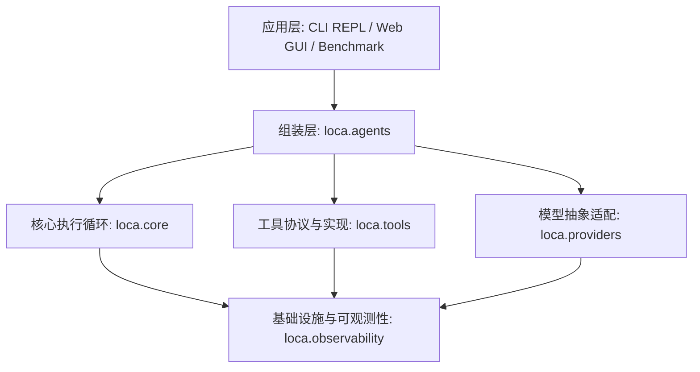

# Loca: 轻量级 Coding Agent 运行时底座 (Harness)

[](https://www.python.org/downloads/)
[](https://opensource.org/licenses/MIT)
[]()
[]()
[-brightgreen.svg)](docs/benchmark.md)

Loca 是一个专为自动化编码任务打造的轻量级、零重型框架依赖的 Coding Agent Harness（运行时底座）。

通过统一抹平 DeepSeek、Anthropic 与 OpenAI 的工具调用（Tool Calling）协议，Loca 提供了工业级的容错执行循环、深度适配 Windows 的双 Shell 宿主安全防御体系、会话断点续聊与原子级快照回滚，以及全链路可观测性双写追踪与自动化行为评测基准。

---

## 目录

- [概述：为什么自研 Harness？](#概述为什么自研-harness)
- [核心系统架构](#核心系统架构)
- [工程亮点与关键机制](#工程亮点与关键机制)
- [前置要求](#前置要求)
- [快速入门](#快速入门)
- [使用指南](#使用指南)
  - [1. 命令行交互 (CLI REPL)](#1-命令行交互-cli-repl)
  - [2. 浏览器可视化界面 (Web GUI)](#2-浏览器可视化界面-web-gui)
  - [3. CLI 命令参考表](#3-cli-命令参考表)
  - [4. VS Code 一键调试集成](#4-vs-code-一键调试集成)
- [自动化行为评测 (Benchmark)](#自动化行为评测-benchmark)
- [项目代码组织结构](#项目代码组织结构)
- [质量保证与验证](#质量保证与验证)
- [深入技术文档](#深入技术文档)
- [参与贡献](#参与贡献)
- [开源许可证](#开源许可证)

---

## 概述：为什么自研 Harness？

主流 Agent 项目往往简单地将提示词包裹在通用 LLM SDK 之上，或者过度依赖 LangChain、LlamaIndex 等高阶编排框架。然而在真实的自动化编码场景中，90% 以上的工程复杂度都集中在运行时底座（Harness）这一层：

| 关键挑战 | 常见工程痛点 | Loca 解决方案 |
| :--- | :--- | :--- |
| **协议碎片化** | 各厂商在 Tool Calling 模式、思考过程（`reasoning_content`）与分片事件格式上差异显著。 | 统一抽象 `LLMProvider`，引入基于 `Draft7Validator` 的前置强校验，参数畸形时构造结构化错误引导模型自我修正。 |
| **执行脆弱性** | 网络抖动（429 限流、504 超时）、Token 超限截断、畸形参数常导致 Agent 进程崩溃。 | 首包到达前实施指数退避重试；长度超限时自动无缝续写；预算告警时调度自适应语义压缩。 |
| **并发与阻塞** | 同步执行耗时推理会挂起 Web 异步事件循环；多文件顺序读取延时成倍累加。 | 服务端将执行循环解耦至后台独立工作线程；单步多只读工具调用自动并发执行并严格维持事件保序。 |
| **宿主环境风险** | 模型幻觉或提示词注入易触发高危指令（如误删系统文件），超时易留下孤儿死锁进程。 | 解释器显式绝对路径寻址（避免 `shell=True`）；前置拦截破坏性命令；系统级超时强杀整棵子进程树。 |
| **缺乏改动退路** | 代码一旦被 Agent 误改破坏，开发者缺少低成本、可复原的确定性撤销机制。 | 执行文件写操作前自动拍摄原子快照；支持一键撤销并对新增文件执行物理删除。 |
| **优化缺乏基准** | 依靠人工体感调优，改动缺乏可量化、可复现、防拟合的评价体系。 | 包含 36 道三级难度的实战任务集；采用独立沙箱纯行为式判分（执行测试与校验），杜绝代码比对噪音。 |

> [!NOTE]
> 设计原则：Loca 刻意摒弃一切第三方重型 Agent 框架，核心控制流全部自研，确保执行流程具备确定性、可测试性与全链路可复现性。

---

## 核心系统架构

Loca 采用严格的单向依赖层次结构，保证核心纯净无污染，彻底杜绝循环依赖：



---

## 工程亮点与关键机制

### 1. 跨厂商统一协议层
- **多模型无缝切换**：抽象厂商中立的 `LLMProvider` 接口，支持 DeepSeek、OpenAI 与 Anthropic。DeepSeek 与 OpenAI 共享协议兼容层，Anthropic 采用独立的流式事件与工具映射翻译层。
- **参数严格前置校验**：基于 `jsonschema` 对模型吐出的工具调用进行强类型前置校验。参数畸形时抛出结构化错误回灌上下文引导模型自纠，杜绝运行时异常打断 Agent。
- **一致性保证**：跨厂商的流式事件与工具分发逻辑均配有参数化回归测试保障。

### 2. 高容错流式执行循环
- **首包前防抖重试**：针对限流（429）、网关超时（504）等瞬时故障实施指数退避重试，且严格限制在首个分片到达前重试，坚决不向用户重放已显示的内容。
- **截断自动续写**：遇到 `finish_reason=length` 触发长度超限时，自动无缝注入后续指令完成拼接。
- **自适应摘要压缩**：Token 预算超限时，调度模型将早期对话提炼为核心摘要钉在窗口头部（支持 `tiktoken` 真实分词），避免粗暴丢弃历史造成关键信息失忆。
- **异常优雅降级**：不可恢复的 Provider 异常以标准 `error` 事件回传，不掐断 SSE 连接与长轮询。

### 3. 高并发与异步非阻塞调度
- **Web 端后台工作线程池**：FastAPI / SSE 服务端将同步阻塞的 Agent 执行循环解耦至后台独立工作线程，通过 `asyncio.Queue` 实现线程安全推流，彻底解决长耗时推理阻塞 Uvicorn 事件循环导致 `/api/health` 假死的问题。
- **只读工具并发加速**：单步批次工具调用若均为只读操作（如同时 `read_file` 多个文件），自动通过线程池并发拉取，严格维持结果回灌与事件流的保序性，成倍降低阅读耗时。

### 4. 双 Shell 宿主纵深防御
- **原生双 Shell 支持**：针对 Windows 开发机场景，提供现代双解释器：`bash`（Git Bash，默认主力，跑测试/Git）与 `powershell`（处理 Windows 专有 cmdlet 与注册表），均解析为显式绝对路径，彻底告别脆弱的 `shell=True`。
- **高危破坏性指令拦截**：内置敏感模式前置拦截机制，拦截 `rm -rf /`、`rm -rf C:\`、`del /s /q`、`format`、`shutdown` 等毁灭性指令，阻断破坏并反馈错误引导模型自纠。
- **超时强杀进程树**：基于 `CREATE_NEW_PROCESS_GROUP` 与系统底层 API，执行超时后精准强杀整棵子进程树，杜绝后台死锁与孤儿进程占用端口。
- **三维输出截断**：按行长、行数、总字节三重防护截断输出，并完全隔离宿主敏感的 `LOCA_*` 环境变量。

### 5. 断点续聊与原子级快照回滚
- **SQLite WAL 状态持久化**：默认落地 `~/.loca/sessions.db`，会话随时跨进程恢复续聊。
- **写前快照与精准回滚**：`write_file` 与 `edit_file` 执行前自动为目标文件保存原子快照。通过 `loca rollback <session> <step>` 可一键回滚到任意历史步之前；新建的文件会被物理删除而非清空，Web GUI 提供一键撤销（undo）操作。

### 6. 全链路双写可观测性 (Trace)
- **SQLite + JSONL 双写冗余**：记录每个模型步的 Prompt 摘要、回复、思考内容（`reasoning`）、工具执行耗时与 Token 开销。即便数据库损坏或删除，纯文本 `.jsonl` 镜像仍可用于复盘。
- **结构化报告渲染**：`loca report <session>` 支持终端美化表格打印、`--verbose` 展开逐步细节及 `--json` 供自动化脚本消费。

---

## 前置要求

在部署与运行 Loca 前，请确保开发环境满足以下要求：

| 项目 | 规格要求 | 说明 |
| :--- | :--- | :--- |
| **操作系统** | Windows 10 / 11 | 针对 Windows 原生路径与控制台深度优化 |
| **Python** | 3.13+ | 推荐使用标准 CPython 3.13 解释器 |
| **Shell 环境** | Git Bash + PowerShell | Git Bash 作为默认主力执行器，PowerShell 处理系统命令 |
| **API 凭证** | DeepSeek / OpenAI / Anthropic | 具备有效可用额度的 API Key（推荐配置 DeepSeek） |

---

## 快速入门

按照以下步骤即可在本地完成环境配置与离线自检：

### 1. 克隆代码仓库
```powershell
git clone https://github.com/your-username/loca.git
Set-Location loca
```

### 2. 创建并激活虚拟环境
```powershell
python -m venv .venv
.\.venv\Scripts\Activate.ps1
```

> [!TIP]
> 若在 PowerShell 下遇到执行策略限制，可先在当前终端执行：  
> `Set-ExecutionPolicy -Scope Process -ExecutionPolicy Bypass`

### 3. 安装项目依赖
```powershell
pip install -e ".[dev]"
```

### 4. 配置环境变量
```powershell
Copy-Item .env.example .env
```
打开 `.env` 文件填入 API 密钥：
```ini
DEEPSEEK_API_KEY=your_deepseek_api_key_here
```

### 5. 验证安装
运行全量离线自动化测试套件：
```powershell
pytest -m "not live"
```
终端显示 `485 passed` 即表示系统各组件装配完备。

---

## 使用指南

Loca 支持命令行流式终端 (CLI REPL) 与浏览器图形界面 (Web GUI) 两种工作模式，两者底层共享同一会话持久化与状态存储机制。

### 1. 命令行交互 (CLI REPL)

使用 `loca chat` 启动交互式 Agent 对话：

```powershell
loca chat --workspace D:\Projects\repo
```

#### 会话交互展示
```text
loca · provider deepseek · 5 tool(s) · workspace D:\Projects\repo

you › 请阅读 README.md 并总结核心优势
assistant → read_file(path='README.md')
[OK] read_file
assistant Loca 的核心优势主要体现在三个方面...
                        steps 1  ·  tokens 812  ·  finish stop
```

> [!TIP]
> REPL 快捷指令：在交互会话中输入 `/help` 查看所有命令、`/compact` 手动触发上下文压缩、`/rollback` 撤销上一轮文件修改、`/session` 查看当前会话状态、`/trace` 查看耗时与开销明细。

### 2. 浏览器可视化界面 (Web GUI)

内置基于 FastAPI + SSE 的单页交互应用，支持思考过程折叠、工作空间动态切换与一键快照回滚。

#### 启动方式：
- **快捷方式（推荐）**：直接双击根目录下的 `run_gui.bat`（或在终端执行 `.\run_gui.bat`），服务启动后将自动唤起默认浏览器打开 `http://127.0.0.1:8765`。
- **命令启动**：
  ```powershell
  # 标准启动
  loca serve
  # 指定端口或开启热重载
  loca serve --port 8765 --reload
  ```

### 3. CLI 命令参考表

| 功能分类 | 命令格式 | 用途说明 |
| :--- | :--- | :--- |
| **对话会话** | `loca chat` | 启动交互式 Agent 对话（默认持久化至 SQLite）。 |
| | `loca chat --workspace <dir>` | 指定 Agent 运行的沙箱工作区根目录。 |
| | `loca chat --session <id>` | 恢复指定会话断点续聊（不存在则新建）。 |
| | `loca chat --no-tools` | 纯流式模型直聊模式（用于排查网络与 Provider 故障）。 |
| | `loca chat --no-save` | 临时体验模式（内存运行，不留存数据库与快照）。 |
| **会话管理** | `loca sessions` | 列出本地所有已保存的历史会话列表与步数统计。 |
| | `loca sessions show <id>` | 打印指定历史会话的对话记录与轨迹流。 |
| | `loca sessions rm <id>` | 彻底删除指定会话记录及其关联的所有文件快照。 |
| **状态回滚** | `loca rollback <session> <step>` | 将指定会话的文件状态还原至第 `<step>` 步之前。 |
| **轨迹报告** | `loca report <session>` | 打印该会话的完整耗时、Token 开销与调用轨迹表。 |
| | `loca report <session> --verbose` | 展开显示各步骤的详细思考过程与工具调用参数。 |
| | `loca report <session> --json` | 以 JSON 格式输出结构化指标，便于自动化处理。 |
| **评测基准** | `loca bench run` | 并发执行 36 道自动化行为评测并输出汇总报告。 |
| | `loca bench verify` | 自检评测集完整性（验证初始状态必挂、参考解必过）。 |
| **服务与工具** | `loca serve` | 启动 Web UI 后台服务（默认 `127.0.0.1:8765`）。 |
| | `loca tools` | 列出当前已注册的所有可用工具及其描述。 |
| | `loca providers` | 查看各主流厂商 Provider 的凭证配置与就绪状态。 |

### 4. VS Code 一键调试集成

项目根目录配齐了完善的 `.vscode/launch.json`，按下 `Ctrl+Shift+D` 即可选中一键启动：
- **`loca chat (CLI REPL)`**：直接在 VS Code 集成终端启动交互式对话。
- **`loca serve (Web GUI)`**：启动后台服务并自动调起浏览器打开页面。
- **`pytest (offline)`**：一键离线回归验证所有 485 项单元测试。

---

## 自动化行为评测 (Benchmark)

Loca 包含一套自带 36 道实战任务的自动化行为评测基准：
- **行为式判分，不比代码 Diff**：跑真实的执行循环与真实工具，只看最终行为（执行 `pytest`、比对标准输出、运行校验脚本）。
- **严格沙箱与防作弊机制**：判分用例存放在 `hidden/` 目录下，模型执行期间物理不可见；判分前才覆写回沙箱，模型修改自身测试用例完全无效。
- **任务集自校验 (Verify)**：`loca bench verify` 自动校验初始状态必失败、参考答案必通过，从机制上排除假阴性与噪音干扰。

### 最新实测表现 (DeepSeek-Chat)

- **评测模型**：`deepseek-chat`
- **运行环境**：Windows 双 Shell（Git Bash 主力 + PowerShell）+ 宿主安全防御底座
- **测试配置**：36 道自带行为式任务，每题单次运行，4 并发执行
- **核心指标**：**pass@1 = 97.2%（35/36）**

| 难度分级 | 题目数量 | 通过题数 | 通过率 | 平均 Token 消耗 / 题 | 平均步数 / 题 |
| :--- | :---: | :---: | :---: | :---: | :---: |
| **简单 (Simple)** | 14 | 13 | 92.9% | 11,355 | 5.2 |
| **中等 (Medium)** | 12 | 12 | 100.0% | 16,803 | 5.8 |
| **困难 (Hard)** | 10 | 10 | 100.0% | 18,686 | 5.4 |
| **全量合计** | **36** | **35** | **97.2%** | **15,074** | **5.3** |

全量评测累计消耗 536k tokens，并发总耗时 72 秒。高难度题（Hard）10/10 全部一次性通过。原始报告存档于 [docs/benchmarks/deepseek-36.json](docs/benchmarks/deepseek-36.json)，评测复现与归因详见 [docs/benchmark.md](docs/benchmark.md)。

---

## 项目代码组织结构

```text
loca/
├── cli.py             # 统一 CLI 入口：chat / sessions / rollback / report / bench / serve / tools
├── agents.py          # Agent 策略定义（提示词 / 工具集 / 预算限额）及装配点 build_agent()
├── providers/         # 厂商中立的 LLM 抽象层 + DeepSeek / OpenAI / Anthropic 适配实现
├── tools/             # 工具抽象协议与强类型校验 + read_file / write_file / edit_file / bash / powershell
├── core/              # 核心执行循环（AgentLoop）、事件系统、错误恢复、上下文压缩管理器
├── observability/     # SQLite 持久化（SessionStore）、快照与回滚管理器（CheckpointManager）、Trace 收集
└── eval/              # Benchmark 评测基准：36 道实战题目、并发执行引擎、自动化判分与自校验

web/                   # FastAPI + SSE 异步非阻塞服务端与单页 Web 聊天应用
scripts/               # 启动辅助脚本
docs/                  # 深度实战与设计指南（CLI、Web GUI、会话回滚、轨迹报告、评测集）
tests/                 # 485 项全离线自动化测试套件 + 8 项真实 API 端到端测试
```

---

## 质量保证与验证

在提交任何代码或功能变更前，必须依次执行并通过以下三项质量验证：

```powershell
# 1. 离线单元测试（必须 100% 通过，当前基准：485 项通过）
pytest -m "not live"

# 2. 静态代码分析与格式规范（必须零警告/零报错）
ruff check .

# 3. 评测集完整性与判分器自检（36 题必须全部正常通过）
python -m loca.cli bench verify
```

---

## 深入技术文档

- [CLI 终端运行与交互详解](docs/running-the-cli.md) — 命令行参数、REPL 快捷指令与会话流控
- [Web GUI 架构与网络排错说明](docs/running-the-web-gui.md) — 异步解耦推流机制与网络故障排查
- [会话持久化、检查点与快照回滚机制](docs/sessions-and-rollback.md) — SQLite WAL 机制与写前快照原理
- [执行轨迹（Trace）双写与报告解析](docs/traces-and-reports.md) — Trace 双写冗余与指标报表解读
- [自动化评测集（Benchmark）设计与可信度剖析](docs/benchmark.md) — 行为式判分沙箱与防作弊机制
- [复盘思考：如何科学评测一个 Coding Agent](docs/blog-benchmarking-a-coding-agent.md) — Coding Agent 评测方法论深度探讨

---

## 参与贡献

欢迎提出 Issue 或提交 Pull Request。参与贡献前请注意：
- 阅读 [AGENTS.md](AGENTS.md) 了解严格的单向依赖流向守则与宿主安全防御规范。
- 遵循 [Conventional Commits](https://www.conventionalcommits.org/) 提交信息规范（如 `feat(...)`、`fix(...)`、`test(...)`、`refactor(...)`）。

---

## 开源许可证

本项目基于 [MIT License](https://opensource.org/licenses/MIT) 开源。
